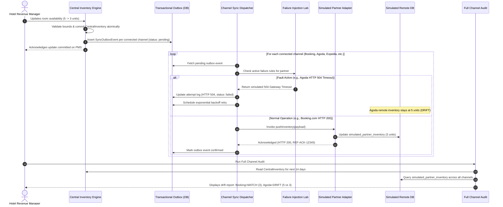
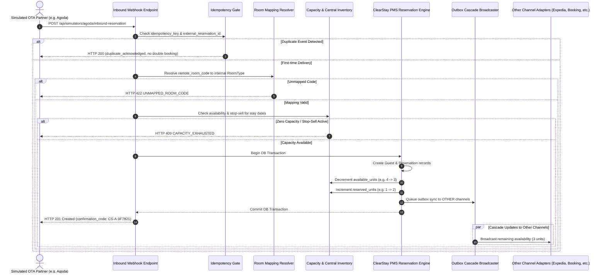
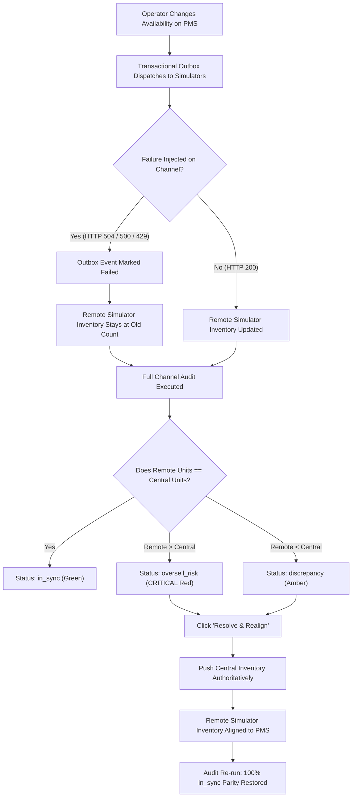

# ClearStay 4.2 — Channel Workflow Diagram

**Document:** Distribution Architecture & Simulation Workflow  
**Author:** Antigravity AI Engineering  
**Application:** ClearStay Hospitality Engine (Version 4.2)  
**Date:** 2026-11-14  

---

## 1. Outbound Inventory & Rate Synchronization Workflow

---

## 2. Inbound OTA Booking Webhook Workflow

---

## 3. Discrepancy Detection & Realignment Lifecycle

